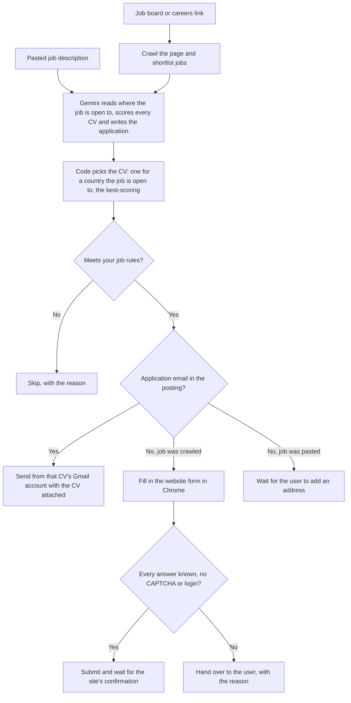

# Job Finder

A local Django dashboard that automates job applications: it reads job adverts and job boards, scores each job against your CVs with Gemini, writes a tailored application and sends it by email or through the employer's website form.
It saves hours of repetitive applying, while hard-coded rules stop it applying to jobs that don't fit or guessing answers it doesn't know.

## How it works



## Technical infrastructure

| Layer | Technology | How it's used |
| --- | --- | --- |
| Web app | Python 3.10+, Django 5.2 | Server-rendered templates with CSRF protection and host validation. No front-end JavaScript: live progress uses an iframe that refreshes itself. |
| Data | SQLite, Django ORM | Your details, CVs, applications and crawl runs, with versioned migrations and atomic status changes. |
| AI | Gemini REST API | Structured JSON through response schemas, automatic fallback to a second model, and capped timeouts and retries. |
| Crawling | requests, BeautifulSoup | Honours robots.txt, limits request rate and download size, and reads schema.org JobPosting data. |
| Browser automation | Playwright, Chrome | Reads forms with injected JavaScript, including iframes and React-style dropdowns, and renders pages that need JavaScript. |
| Documents | pypdf, python-docx | Extracts CV text, links and contact details locally, and tells which country a CV is for from its location and phone code. Gemini reads scanned PDFs. |
| Email | Django mail, Gmail SMTP over SSL | Sends the tailored message with the CV attached, from the Gmail account matching that CV's email. Up to 10 accounts, each with its own App Password. |
| Background work | Python threads | Crawling, tailoring, sending and form filling run off the request thread. One worker owns the browser, and interrupted work is recovered on restart. |
| Testing | Django test runner, headless Chrome | 666 tests, including real-browser runs against a local fake job site and deliberately hostile pages. |

## Project layout

| Path | Responsibility |
| --- | --- |
| `core/pipeline.py` | Orchestrates each application: choose a CV, tailor, apply the rules, send or queue |
| `core/formfill.py` | Finds, fills in and submits website forms, and decides when to stop |
| `core/crawler.py` | Fetches pages safely and extracts text, links and email addresses |
| `core/llm.py`, `core/prompts.py` | Gemini client, model fallback, prompts and response schemas |
| `core/emails.py` | Finds real application addresses in text, including obfuscated ones |
| `core/mailer.py` | Gmail SMTP sending and readable error messages |
| `core/resume.py`, `core/countries.py` | CV text, contact details, links and country |
| `core/models.py`, `core/views.py`, `core/templates/` | Data model and dashboard |
| `core/tests/` | Test suite, including the fake job site |

## Engineering highlights

- **Model output is treated as untrusted.** The model can only pick a recipient from addresses printed in the posting; only the user can type a different one. Text from the web is fenced in prompts against injection, and form answers are checked against the options on the page.
- **Fixed rules overrule the model.** A wording check rejects hybrid jobs the model approved, the code rather than the model decides which CV a job may get, eligibility and salary answers are only accepted when the model attributes them to the user's stated facts, and passwords, bank details and date of birth are never filled in.
- **Guards against duplicate applications.** Atomic status updates stop a double click sending twice, and a unique hash per pasted text or job URL stops the same advert being processed again. A send interrupted by a crash is flagged for the user rather than retried.
- **Browser actions are conservative.** It only submits through a button whose label plainly means submit. Success needs both data accepted by the site and a new confirmation. Honeypot fields stay empty, and CAPTCHAs and logins are handed to the user, never bypassed.
- **Network access is guarded.** Page navigations and redirects in the crawler and the browser are checked against private addresses, so a job page can't send it to a local service.
- **Readable job descriptions, in the employer's own words.** Pasted adverts are laid out as headings and lists without Gemini. A crawled page is tidied by Gemini once, in the background, and the result is only kept if almost every run of three words in it appears in the original, so it can drop page clutter but never reword the job.
- **Resilient to overloaded APIs.** Model fallback and capped timeouts keep work moving, and the one Gemini call made during an upload, for scanned CVs, skips long retries. Regexes that scan untrusted pages are bounded and tested against hostile input.
- **Secrets stay out of the code.** Keys are read from `.env` at runtime and sent in headers, and passwords are never rendered back to the page.

## Run it

Needs Python 3.10 or newer and Google Chrome.

```bash
git clone https://github.com/lord-hamza/job-finder.git
cd job-finder
./run.sh
```

This creates the virtual environment, installs dependencies, creates `.env` from `.env.example` and runs migrations. The dashboard is at http://127.0.0.1:8765, and it opens by itself on macOS.

## Your CVs and job rules

Upload one CV for each country or kind of work you apply for, all at once. Each CV is its own identity: its name, email, phone, LinkedIn, other links such as GitHub and the country it's for are read from the file when it's uploaded, including details that are only clickable links, and can be corrected in Setup. The country comes from where the CV says you are and from its phone number's country code. Each CV also has its own facts, typed in Setup, which answer form questions about location, right to work, notice and salary.

For every job, Gemini reads where it's open to and scores each CV, and the code decides which CV it gets:

| The job | The CV it gets |
| --- | --- |
| On-site, hybrid, or not clearly remote | A CV for a country where your rules allow on-site work. Anywhere else, it isn't applied to. |
| Remote, limited to some countries | That country's CV. With none, it waits for you rather than going with another country's. |
| Remote, and the posting says anyone anywhere can apply | Your best-matching CV, and with "one CV per country" on, the best CV of each other country that scores your minimum and has its own email address and Gmail account, each as a separate application. An employer in a country where your rules allow on-site work only gets that country's CV. |
| Remote, with no limit stated | The CV for the country the employer is in, or your best match. |

The email goes out from the Gmail account with that CV's address, signed with that CV's name, phone and LinkedIn, and website forms are filled in with its details. Your consent setting and job rules are shared by all your CVs.

Job rules are set in the dashboard under "Where you'll work", so anyone can use it:

| Setting | Default | Meaning |
| --- | --- | --- |
| On-site, hybrid or remote are all fine in | `Pakistan, Lahore, Islamabad, Karachi, Rawalpindi` | Jobs that mention one of these places can be on-site, hybrid or remote. Leave it empty to apply to remote jobs only. |
| Anywhere else, fully remote jobs open to people in | `United Kingdom, United States` | Everywhere else, only fully remote jobs based in these countries, limited to them, or open to anyone anywhere. Leave it empty for any country. |
| One CV per country | On | A job open to anyone anywhere also goes with the best CV of each of your other countries. |

## Configuration

Add these to `.env`. The required keys can also be entered in the dashboard:

| Setting | Required | Default | Purpose |
| --- | --- | --- | --- |
| `GEMINI_API_KEY` | Yes | | Key from [Google AI Studio](https://aistudio.google.com/apikey) |
| `GMAIL_ADDRESS` | Yes | | An address applications are sent from |
| `GMAIL_APP_PASSWORD` | Yes | | [App Password](https://myaccount.google.com/apppasswords), which needs 2-Step Verification on |
| `GMAIL_ADDRESS_2`, `GMAIL_APP_PASSWORD_2`, ... | No | | More accounts, up to 10 |
| `GEMINI_MODEL` | No | `gemini-flash-lite-latest` | Preferred Gemini model |
| `MIN_MATCH_SCORE` | No | `60` | Crawled jobs scoring below this are skipped |
| `DAILY_SEND_LIMIT` | No | `25` | Most emails and forms submitted per day from each Gmail account |
| `CRAWL_MAX_JOBS` | No | `15` | Most job pages opened per link |

## Tests

```bash
.venv/bin/python manage.py test
```

The suite takes about 8 minutes, because the form tests run in real headless Chrome. It never contacts real sites or sends real email.
